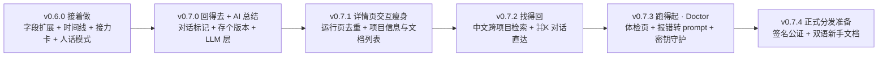
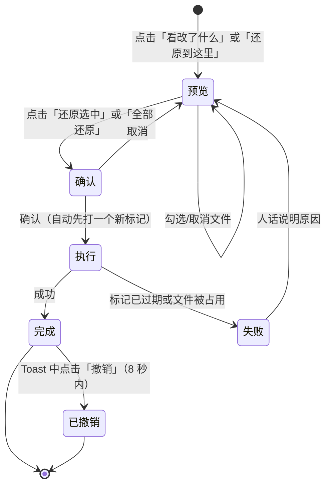

# 面向小白 Vibe Coder 的能力深化规划

> 配套文档：[CAPABILITIES_AND_ROADMAP.md](./CAPABILITIES_AND_ROADMAP.md)（现有能力全量梳理）。
> 本文回答：**小白到底卡在哪 → 方向 1「AI 会话记忆中枢」的能力边界 → 轻量「对话标记」替代存档点 → LLM 总结怎么接 → 版本任务拆解**。
> **当前基线（2026-11-27）**：`v0.6.0–v0.7.3` 已落地；`v0.7.4`（Build 12）进入分发准备，版本、签名/公证脚本、双语新手文档和官网已同步，真实更新与公证待发布验收。

**已拍板（2026-11-27）**

| 决策 | 结论 |
| :--- | :--- |
| 影子存档点 | ❌ 太重，不做 → 改为轻量 **「对话标记」+「存个版本」**（第三节） |
| 接力卡 | ✅ 轻量路线：**只复制到剪贴板，绝不写入项目文件** |
| 人话模式 | ✅ 加入，面向小白**默认开启** |
| LLM 总结 | ✅ 引入，作为**可开关的增强层**，规则提取始终兜底（第四节） |
| 详情页页签 | ✅ 合并精简为 **进度 / 运行 / 版本 / 项目信息** 4 个，人话与专业模式共用同一套页签，只切换文案（8.2） |
| 侧栏「对话」 | ✅ **v0.6 上线**，先做全局对话时间线，**v0.7.2** 叠加跨项目搜索（8.2） |
| 项目体检 Doctor | ✅ 独立侧栏「体检」（取代「可清理」），**按关注 / 闲置分层**，不做无差别全盘扫（第九节） |
| 隐形版本 ② | ✅ 默认开启，首次触发时弹 Toast 说明「保留约 14 天」 |
| LLM 首推 Provider | ✅ 优先引导复用本机已登录的 Agent CLI（按检测结果推荐） |
| 「存个版本」提示频率 | ✅ 同一项目 30 分钟内最多提示 1 次，支持「不再提示」 |
| 关注上限与活跃窗口 | ✅ 默认合计上限 **8 个**，自动活跃窗口 **7 天** |
| 腾空间默认动作 | ✅ 人话模式默认**移到废纸篓**（可恢复），专业模式可切回「复制清理命令」 |
| 「安装依赖」确认策略 | ✅ 仅首次联网安装时确认，之后对关注项目一键执行（日志区可见、可停止） |

---

## 一、先换用户视角：小白和熟练开发者完全是两类人

| 维度 | 熟练开发者 | 小白 vibe coder |
| :--- | :--- | :--- |
| 工作单位 | Commit / PR / 分支 | **一次和 AI 的对话** |
| 对 Git 的认识 | 日常工具 | 不知道是什么，很多项目**根本没 `git init`**，从不 commit |
| 最怕的事 | 合并冲突、CI 红 | **AI 把能跑的东西改坏了，回不去** |
| 最常问的话 | 「这个 PR 能合吗」 | 「我上次做到哪了？」「怎么又跑不起来了？」「这报错啥意思？」「花了多少钱？」 |
| 项目数量 | 少而深 | **多而浅**：Agent 一句话就建一个文件夹，散落各处、名字随机 |
| 风险盲区 | 少 | `.env` 里的 API Key 被推到 GitHub、`node_modules` 塞满硬盘、端口被僵尸进程占着 |

**结论**：对小白最值钱的是三件事——**记得住**（方向 1）、**回得去**（对话标记）、**跑得起**（Doctor）。三者都建立在 FizzDeck 已经在读的 AI 会话日志之上，这是 Git 客户端、IDE、单个 Agent 都没有的跨工具视角。

---

## 二、方向 1「AI 会话记忆中枢」的能力边界

### 2.1 一句话定义

> **FizzDeck 只读本机各家 Agent 已写在磁盘上的会话日志，整理成「按项目的工作记忆」，并在需要时把这份记忆（以剪贴板形式）交还给任意 Agent。**

它是**记录员 + 交接员**，不是 Agent 本身。

### 2.2 做什么 / 不做什么

| ✅ 在边界内 | ❌ 明确不做 |
| :--- | :--- |
| 读取 Codex / Claude Code / DSH / AGY / Grok / Gemini CLI 会话文件，增量建索引 | 内置聊天框、让 LLM 写代码 |
| 规则提取：首句需求、最后需求、改了哪些文件、最后一次报错、Token/费用 | 把规则提取换成「必须联网 LLM 才能用」 |
| 可选 LLM 总结：把规则提取结果润色成人话（第四节） | 默认把会话内容发给任何第三方 |
| 按项目串成进度时间线，生成**仅复制**的接力卡 | 写入 `AGENTS.md` / `CLAUDE.md` 或任何项目文件 |
| 跨项目搜索会话（中文可用） | 向量库 / RAG / 语义检索（首版） |
| 估算单项目、单会话花费 | 评价代码质量、评价 AI 做得好不好 |
| 索引存 `~/.repodeck`，展示与发送前对密钥脱敏 | 上传、同步、团队共享 |
| Cursor / Trae / Windsurf 只展示「工作区摘要」 | 承诺这几家也有完整对话 |

### 2.3 数据现实：先扩字段，再做 UI

当前 [`SessionRecord`](file:///Users/a003/dsh-workspace/repo-dashboard/macos/Sources/FizzDeck/Services/SessionIndex.swift) 只有 `tool / id / cwd / startedAt / modified / lastUser / model / usage / costUSD`。需要新增：

| 新字段 | 来源 | 可靠度 |
| :--- | :--- | :--- |
| `firstUser`（这次想干嘛） | 日志第一条 user 消息 | 高 |
| `touchedFiles`（改了哪些文件） | Codex `apply_patch`、Claude `Edit/Write` 等工具调用 | 中：逐家适配，IDE 类拿不到 |
| `lastError`（最后一次报错片段） | 工具返回中的非零退出 / `Error:` 片段 | 中：启发式，只做提示 |
| `turnCount` / `durationMinutes` | 消息数、首尾时间戳 | 高 |

> [!WARNING]
> 小白很少 commit，原路线图「会话关联的 Commit 产出」对他们失效；产出指标改用 `touchedFiles`。

### 2.4 方向 1 分层与优先级

| 层 | 小白视角名字 | 内容 | 价值 |
| :--- | :--- | :--- | :--- |
| **L1** | 我做到哪了 | 会话页改为进度时间线：想做什么 → 改了哪些文件 → 结束状态 → 花费 | ★★★★★ |
| **L1+** | 接着做（接力卡） | 一键复制 Markdown 接力卡给任意 Agent（见 2.5） | ★★★★★ |
| **L2** | 找回来 | `⌘K` 深化为跨项目会话搜索 | ★★★★ |
| **L3** | 花得值不值 | 单项目 / 单会话花费排行、本月累计、缓存节省 | ★★★ |
| **L4** | 本周回顾 | 原日报/周报，改为可选「本周学习回顾」 | ★ |

### 2.5 接力卡（轻量版）

- **只有一个出口：复制到剪贴板。** 不落盘到项目、不自动注入 Agent、不改任何配置。
- 两档内容：
  - **规则版（默认、离线、即时）**：项目名 + 技术栈 + 启动命令；最近 3 次对话的首句需求与改动文件；最后一次报错片段；Git/改动状态（人话描述）。
  - **AI 润色版（开启 LLM 后可选）**：在规则版基础上补「目前完成了什么 / 卡在哪里 / 建议下一步」三段。
- 入口：项目详情会话页顶部「复制接力卡」、`⌘K` 动作、菜单栏最近项目右键。
- 长度上限约 1.5k 字，避免把接手的 Agent 上下文塞满；复制前统一密钥脱敏。

### 2.6 L2 搜索的中文坑

- SQLite FTS5 默认 `unicode61` 不切中文 → 用 `trigram` 分词器；
- trigram **少于 3 字符无法 MATCH**，而「登录 / 支付 / 报错」都是 2 字 → 短查询回退 `LIKE '%…%'`（单机几千条会话量级足够快）；
- 只索引 user 消息与首尾 assistant 片段，不索引完整工具输出；结果片段展示前脱敏。

---

## 三、轻量替代存档点：「对话标记」+「存个版本」

### 3.1 为什么之前的方案重

影子 Git 目录 = 每个项目一份独立对象库 + 独立快照服务 + 清理策略，磁盘与心智成本都高。

### 3.2 新方案：三档由轻到重，按需叠加

| 档位 | 是什么 | 写了什么 | 能干什么 | 触发 |
| :--- | :--- | :--- | :--- | :--- |
| **① 纯标记** | 在时间线上记一个「对话开始」点 | 只写 `~/.repodeck/marks.json`：会话 ID、时间、`HEAD` SHA、当时的改动文件清单 | 显示「这次对话开始时项目是什么状态」 | 检测到新会话，自动 |
| **② 隐形版本** | 把「此刻工作区」记成一个 Git 版本，但**不挂在任何分支上** | 仅向项目 `.git` 写入 Git 对象（不动分支、不动工作区、不动暂存区、不出现在 `git log`）；SHA 记在 `marks.json` | **看这次对话改了什么**（Diff）、**还原单个文件**、**整体还原到对话前** | 检测到新会话，自动（默认开启，可关） |
| **③ 存个版本** | 一次真正的 Git commit | 当前分支新增一个 commit，提交信息由 LLM 根据会话生成（规则兜底） | 正式留档，可推送；顺便教会小白「commit 是什么」 | **用户点击**；对话结束且改了文件时温和提示「要把这次改动存成一个版本吗？」 |

**② 是替代存档点的核心**，实现只需几条 Git 底层命令，用临时 index 文件，完全不碰用户真实暂存区：

```sh
# 在项目目录执行，IDX 指向 ~/.repodeck/tmp/ 下的临时文件
cp .git/index "$IDX"                                   # 复用 stat 缓存，加速
GIT_INDEX_FILE="$IDX" git add -A -- . ':(exclude)node_modules' ':(exclude).next' ':(exclude)dist' ':(exclude).venv'
TREE=$(GIT_INDEX_FILE="$IDX" git write-tree)
MARK=$(git commit-tree "$TREE" -p HEAD -m "fizzdeck mark <session-id>")
rm "$IDX"                                              # MARK 写入 marks.json
```

- `git add -A` 遵守 `.gitignore`，**新建的未跟踪文件也能记进去**（`git stash create` 做不到这点，所以不用它）；
- `commit-tree` 不移动任何引用、不触发 hooks，用户的 `git status` / `git log` / 分支**全无变化**。

### 3.3 还原（全部走 `git restore`，只覆盖不删除）

| 操作 | 命令要点 | 安全措施 |
| :--- | :--- | :--- |
| 看这次对话改了什么 | `git diff <MARK>` 对比当前工作区，复用现有 Diff 组件 | 只读 |
| 还原单个文件 | `git restore --source=<MARK> --worktree -- <file>` | 还原前自动再打一个 ② 标记，可撤销 |
| 整体还原到对话前 | `git restore --source=<MARK> --worktree -- .` | 同上 + 强确认；对话后**新建的文件只列出、由用户勾选是否删除**，绝不自动删 |

### 3.4 边界与诚实提示

| 问题 | 处理 |
| :--- | :--- |
| 隐形版本**会过期**：无引用对象会在 `git gc` 时被清理（默认宽限期约 2 周） | UI 写明「对话标记保留约 14 天」；用户点「⭐ 保留这个标记」时才写 `refs/fizzdeck/<id>` 固定下来；还原前用 `git cat-file -e` 检查是否仍有效 |
| 新会话检测有 ~2 秒防抖，Agent 可能已改了文件 | 文案用「对话开始时的标记」，不承诺绝对原样；Agent 通常先读后写，大多数情况来得及 |
| 没有 `.gitignore` 的小白项目可能把 `node_modules` 全量哈希 | 强制排除常见依赖/产物目录；跳过 >5MB 文件；待加入文件超过 5,000 个时放弃 ② 并降级为 ① |
| 非 Git 项目 | 只能用 ①；配合「非 Git 项目引导」一句话解释并一键 `git init`（含默认 `.gitignore`） |
| ② 确实向 `.git` 写了对象 | 设置中可关闭 ②；关闭后只保留 ① 和 ③ |

> [!TIP]
> 产品故事保持不变但更轻：**FizzDeck 记得你和 AI 的每一次对话，并在每次对话开始时悄悄打个标记——改坏了，点一下就回去。**

---

## 四、LLM 总结层

### 4.1 用在哪（全部有规则兜底）

| 场景 | 规则版 | LLM 增强 |
| :--- | :--- | :--- |
| 单次会话摘要 | 首句需求 + 改动文件 | 一句话「这次做了什么、结果如何」 |
| 项目「做到哪了」 | 最近会话列表 | 三段式：已完成 / 卡点 / 下一步 |
| 接力卡 | 模板拼接 | 润色 + 建议下一步 |
| 「存个版本」的提交信息 | `更新 3 个文件：a, b, c` | 人话 commit message |
| 报错解释（人话模式） | 匹配常见错误词典（端口占用、缺依赖、缺环境变量） | 解释原因 + 给出可粘贴给 Agent 的求助 prompt |
| 本周回顾 | 计数统计 | 叙述式回顾 |

### 4.2 接入方式（按推荐顺序，设置里单选）

| Provider | 说明 | 优点 | 注意 |
| :--- | :--- | :--- | :--- |
| **复用已装的 Agent CLI**（`claude -p`、`codex exec`、`gemini -p`） | 非交互模式调用，用户已有登录/订阅 | 零配置，最适合小白 | 见 4.3「自污染」问题 |
| **OpenAI 兼容 API（BYOK）** | 填 Base URL + Key，覆盖 OpenAI / DeepSeek / 各类中转 | 可选便宜模型、可控 | Key 存 macOS 钥匙串，不写明文 |
| **本地模型**（Ollama / LM Studio） | `127.0.0.1` OpenAI 兼容接口 | 完全离线、隐私最好 | 质量与速度取决于机器 |

### 4.3 关键约束

- **默认关闭，首次开启时明确告知**：会把哪些内容（脱敏后的需求文本、文件名、报错片段）发给哪个 Provider；可在每次生成前预览输入。
- **最小输入**：只送规则提取后的结构化字段，不送完整对话与源码；单次输入上限约 4k token。
- **自污染防护**：用 Agent CLI 生成摘要时，本身会产生新会话日志并被 FizzDeck 索引 → 固定在 `~/.repodeck/llm-workdir/` 下执行，索引时过滤该 `cwd`；其费用在费用环中单独标为「FizzDeck 自身」。
- **缓存与成本**：摘要按 `sessionId + mtime` 缓存到 `~/.repodeck/summaries/`，只在会话结束或用户点击时生成，不后台批量跑；设置中显示本月 FizzDeck 自身消耗。
- **失败静默降级**：超时 / 未登录 / 无网络时直接显示规则版，不弹错。

---

## 五、人话模式（默认开启）

一层**文案映射**，不改功能；设置 → 「界面术语：人话 / 专业」，熟练用户切回专业。

| 专业术语 | 人话 |
| :--- | :--- |
| 未提交改动 | 有改动还没存成版本 |
| Commit / Commit & Push | 存个版本 / 存个版本并上传 |
| 未推送 | 存了但还没上传到 GitHub |
| 落后远端 / Pull | 云端有新内容 / 拿回云端的新内容 |
| Stash | 先把改动收起来 |
| 端口被占用 | 有别的程序占了这个位置，项目开不起来 |
| `node_modules` 未安装 | 项目需要的零件还没装 |
| 对话标记（②） | 对话开始前的样子 |

- 专业术语在人话旁以次级灰字或悬停提示保留，帮助小白逐步学会；
- 报错类文案配合第四节的错误词典 / LLM 解释，始终给出**一个可点击的下一步**。

---

## 六、其余方向对小白的重排

| 原规划项 | 对小白 | 处理 |
| :--- | :--- | :--- |
| 项目体检 Doctor | ★★★★★ | **升级为核心**，每个问题配按钮：「安装依赖」「关掉占用端口的程序」「从模板创建 .env」 |
| 报错一键转 Agent 提示词 | ★★★★★ | **新增**，人话模式 + LLM 解释共用 |
| 密钥泄露守护 | ★★★★ | **新增**：`.env` 未被忽略、已跟踪文件出现 Key 模式时，推送前拦截并用人话解释 |
| 非 Git 项目引导 | ★★★ | 配合对话标记 ②，一键 `git init` + 默认 `.gitignore` |
| 跨栈安全清理 | ★★★ | 保留 |
| Worktree 派单 / 多 Agent 驾驶舱、Hunk 暂存、`gh` PR | ★ | 降为「进阶模式」储备 |
| 全局端口拓扑视图 | ★★ | 并入 Doctor，只在冲突时出现 |
| URL Scheme / AppIntents | ★ | `v1.0` 之后 |

---

## 七、版本任务详情



### `v0.6.0` 接着做（已完成）

| # | 任务 | 涉及模块 | 验收 |
| :--- | :--- | :--- | :--- |
| 6.1 | `SessionRecord` 增加 `firstUser / touchedFiles / lastError / turnCount / durationMinutes`；Codex、Claude 先适配，其余工具字段可空 | `SessionIndex`、`session-cache.json` 版本号升级 | 旧缓存自动失效重建；新增解析单测覆盖两家样例日志 |
| 6.2 | 会话页改为进度时间线 | `ProjectDetailView`、`ProgressTabView` | 隔 3 天打开项目，10 秒内看懂上次让 AI 做了什么 |
| 6.3 | 规则版接力卡 + 脱敏工具函数（复制到剪贴板，三个入口） | `HandoffCardBuilder`、`SecretRedactor` | 粘给另一个 Agent 能直接接着干；样例中的 `sk-` / `ghp_` 被打码 |
| 6.4 | 人话模式文案层 + 设置开关（默认人话） | `FizzCopy`、`AppSettingsView` | Git 页、待处理队列、Toast 全部切换；专业术语悬停可见 |
| 6.5 | 产出指标改为 `touchedFiles` | `DashboardMetrics` | 未 commit 的项目也能显示本周产出 |

### `v0.7.0` 回得去 + AI 总结（已完成）

| # | 任务 | 涉及模块 | 验收 |
| :--- | :--- | :--- | :--- |
| 7.0.1 | 对话标记 ①：新会话检测时写 `marks.json` | `RepositoryStore`、`SessionMarkService` | 时间线每次对话前出现标记点 |
| 7.0.2 | 隐形版本 ②：临时 index + `commit-tree`；排除规则、5MB / 5,000 文件降级；设置可关 | `SessionMarkService` | `git status` / `git log` / 分支无任何变化；大仓库不卡顿 |
| 7.0.3 | 「这次对话改了什么」Diff、还原单文件、整体还原（新文件只列不删）、还原前自动标记、⭐ 固定标记 | `MarkDiffRestoreSheet`、`GitService` | 不开终端，两次点击回到对话前；还原可撤销 |
| 7.0.4 | 「存个版本」：对话结束且有改动时温和提示，提交信息由 LLM / 规则生成；推送前 `.env` 守护 | `GitTabView`、`ToastCenter` | 小白一键产生真实 commit |
| 7.0.5 | LLM Provider 层：Agent CLI / OpenAI 兼容 BYOK（钥匙串）/ 本地模型；首次开启告知 + 输入预览 | `SummaryProvider`、`KeychainStore` | 三种 Provider 均可跑通；无网络时静默回退规则版 |
| 7.0.6 | 自污染防护：`llm-workdir` 执行 + 索引过滤 + 费用单独标记 | `SessionIndex`、`AICostBreakdownCard` | FizzDeck 自身生成的会话不出现在项目列表 |
| 7.0.7 | 会话摘要、项目「做到哪了」、接力卡 AI 润色版；摘要缓存 | `SummaryEngine`、`~/.repodeck/summaries/` | 同一会话不重复计费 |

### `v0.7.1` 详情页交互瘦身与体验打磨（已完成）

| # | 任务 | 涉及模块 | 验收 |
| :--- | :--- | :--- | :--- |
| 7.1.1 | 去掉详情页底部浮动操作栏，所有动作回到各页签内容卡中；将 Toast 弹窗移至右上角向下堆叠 | `ProjectDetailView`、`ContentView`、`ToastOverlayView` | 详情页全屏聚焦内容，Toast 不遮挡阅读与操作 |
| 7.1.2 | 将「文档」页签合并精简为「项目信息」页签（原进度底部的项目备注 + 技术栈与空间 + 精简文档列表卡片点击弹窗预览） | `ProjectInfoTabView`、`ProgressTabView`、`ProjectTab` | 进度页聚焦时间线，项目信息与文档在一处查看 |

### `v0.7.2` 找得回 · 跨项目中文检索（已完成）

| # | 任务 | 涉及模块 | 验收 |
| :--- | :--- | :--- | :--- |
| 7.2.1 | FTS5 `trigram` 会话索引（入库前脱敏）+ 1–2 字 `LIKE` 回退；侧栏「对话」搜索框与 `⌘K` 接入并直达进度时间线节点 | `SessionSearchIndex`、`ConversationsWorkspaceView`、`CommandPaletteView` | 搜「登录」或 3+ 字/文件名均能命中对应对话，点击直达项目进度页 |

### `v0.7.3` 跑得起 · 项目体检 Doctor（已完成）

| # | 任务 | 涉及模块 | 验收 |
| :--- | :--- | :--- | :--- |
| 7.3.1 | Doctor 体检（取代「可清理」）：缺依赖 / 缺 `.env` / 端口冲突 / 僵尸进程，按关注/闲置分层 | `RunDetector`、`PortConflictService`、`AttentionQueueView` | 「项目打不开」时给出可点的修复 |
| 7.3.2 | 报错转 prompt：日志报错 + 栈 + 最近改动文件 → 可复制求助 prompt；人话解释（词典 / LLM） | `ProjectServicesPanel` 日志区 | 小白不需要理解报错也能求助 |
| 7.3.3 | 密钥泄露守护增强（跟踪文件 `git grep`）与非 Git 项目引导 + 一键 `git init` | `GitSyncService`、`ProjectInfoTabView` | 含 Key 的跟踪改动被拦截；非 Git 项目引导后标记 ② 可用 |

### `v0.7.4` 正式分发准备

- 版本号统一为 `0.7.4`（Build `12`），构建脚本支持 `VERSION` / `BUILD_NUM` 覆盖。
- `package_dmg.sh` 支持 Developer ID、Hardened Runtime、DMG 签名、公证、staple 与 `spctl`；未提供身份时保留 ad-hoc。
- 双语新手 README、官网三大主线文案与 `v0.5.3 / v0.7.3 → v0.7.4` 发布验证步骤已补齐。
- 发布前仍需用真实 Developer ID / 公证凭据打一次包，并分别在 `v0.5.3`、`v0.7.3` 上实测应用内下载更新。详见 [CAPABILITIES_AND_ROADMAP.md 第六节](./CAPABILITIES_AND_ROADMAP.md#六v074-发布验证清单)。

---

## 八、Dashboard 信息呈现、布局与交互设计

> 现状基线（`v0.7.4`）：侧栏「工作台 / 对话 / 项目库 / 体检 + 关注 + 正在运行 + 分组」；工作台 [WorkbenchDashboardView.swift](file:///Users/a003/dsh-workspace/repo-dashboard/macos/Sources/FizzDeck/Views/WorkbenchDashboardView.swift) 为「日期 + KPI」头部与继续工作 / 待处理 / 周时间线 / 费用与运行状态；详情页固定 4 页签「进度 / 运行 / 版本 / 项目信息」，旧的「概览 / Git / 文档 / 会话 / 测试 / 清理」已合并或移除。
> 本节的改造原则是**复用现有组件与断点（920pt 双栏、660pt 头部折行），重排信息优先级，而不是推倒重来**。

### 8.1 设计原则（所有界面共用）

| # | 原则 | 落地规则 |
| :--- | :--- | :--- |
| P1 | **以「对话」为主角，Git 退居幕后** | 首页和详情页的第一屏都围绕「最近的 AI 对话」组织；Git 状态只以人话句子出现在需要行动时 |
| P2 | **一张卡回答一个问题** | 卡片标题写成问题或结论：「接着做」「需要你看一下」「花了多少」，不写「Attention Queue」这类名词 |
| P3 | **每张卡最多一个主按钮** | 主按钮用 `.glass` 强调，其余动作收进悬停区或 `⋯` 菜单 |
| P4 | **结论在前，数字在后** | 先给一句话状态（「2 个项目在进行，1 个跑不起来」），数字作为辅助，不再让 KPI 占据头部主视觉 |
| P5 | **永远给下一步** | 任何报错、警告、空状态都必须带一个可点击的动作，不能只描述问题 |
| P6 | **来源透明** | AI 生成的内容带「✦ AI 总结」标签，规则提取的带「自动整理」标签，用户始终知道哪些是推测 |
| P7 | **破坏性操作先预览、可撤销** | 还原、删除一律「预览 → 确认 → 完成 Toast 带撤销」三步 |
| P8 | **渐进披露** | 人话模式下默认隐藏进阶模块（提交热力图、Worktree、Stash），专业模式全部展开 |

### 8.2 信息架构调整

**侧栏（定稿）**

```text
工作台
对话            ← v0.6.0 新增：全局对话时间线；v0.7.2 叠加跨项目搜索
项目库
体检        ●2  ← v0.7.3 取代「可清理」；角标只计关注项目的红/琥珀问题
─────────
关注            ← 原「星标」升级：手动关注 + 自动活跃（见 9.2）
  todo-app   ◉     状态点：◉ AI 正在干活 / 🔴 跑不起来 / 🟠 有改动未存版本
  blog       🟠
  shop       🔴
  · 7 天内活跃（自动）
正在运行        ← 分「服务」「AI」两个小标签
分组
```

| 调整 | 版本 |
| :--- | :--- |
| 新增「对话」：按天分组的全局对话流（项目名 + 工具 + 首句需求 + 状态），点击跳到该项目「进度」页对应节点；顶部按工具 / 状态（报错结束、进行中）筛选 | v0.6.0 |
| 「对话」叠加跨项目搜索框（FTS5 trigram） | v0.7.2 |
| 「星标」→「关注」，状态点只对关注项目显示，避免闲置项目制造噪音 | v0.6.0 |
| 「可清理」→「体检」 | v0.7.3（之前保持「可清理」不变） |

**详情页页签（定稿：4 个，两种模式共用）**

| 页签 | 合并自 | 内容 |
| :--- | :--- | :--- |
| **进度**（默认落地页） | 会话 + 进度汇总 | 「做到哪了」+ 对话时间线 + 对话标记；顶部筛选可切到「全部原始会话」（含 IDE 工作区摘要） |
| **运行** | 测试 + 概览中的 Services / Logs | 体检问题条 + 启动 / 预览 + 脚本 + 测试 + 日志（`v0.7.1` 起取消底部重复浮动操作条，聚焦中间交互区） |
| **版本** | Git | 人话模式与专业模式同一组件，仅文案不同；Stash / 分支 / Worktree 收进「⋯ 进阶」 |
| **项目信息** | 原项目备注 / 简介 / 技术栈 + 精简文档列表 | 项目简介、分组标签、一句话备注、技术栈与空间清理入口、精简文档列表卡片（点击弹窗阅读） |

- 原「清理」页签取消：项目级「腾出空间」移到页头 `⋯` 菜单与「项目信息」空间卡（打开 Sheet），全局清理归入侧栏「体检」。
- 人话 / 专业模式**不再改变页签结构**，只切换文案与进阶区默认折叠，降低维护成本，也避免用户切换模式后找不到东西。

### 8.3 工作台首页（人话模式）

```text
┌───────────────────────────────────────────────────────────────────────────┐
│ 下午好 · 11 月 27 日 星期五                      本周对话 23  改动文件 61  花费 $4.2 │
│ 2 个项目在进行，1 个跑不起来                                                │
├───────────────────────────────────────────────┬───────────────────────────┤
│ 接着做                                          │ 正在运行                   │
│ ┌───────────────────────────────────────────┐ │  ● todo-app   :3000 [打开看看]│
│ │ [封面]  todo-app        ● Claude 刚结束 12 分钟前│ │  ◉ Claude 正在 blog 里干活   │
│ │ 「给待办加上拖拽排序」                        │ ├───────────────────────────┤
│ │ ✦ 拖拽已完成，移动端还没适配                   │ │ 花了多少（本周）            │
│ │ 改了 4 个文件 · 23 分钟 · $0.38               │ │   ◯ 费用环 + 项目排行 Top3   │
│ │ [▷ 继续对话]  复制接力卡  看改了什么           │ │   含「FizzDeck 自身 $0.05」 │
│ └───────────────────────────────────────────┘ ├───────────────────────────┤
│  blog · 「首页加暗色模式」· 昨天    [继续]       │ AI 活动热力                 │
│  shop · 「接入支付」· 3 天前 · ⚠ 报错结束 [继续] │  （对话 + 改动文件，替代     │
├───────────────────────────────────────────────┤   人话模式下的提交热力图）    │
│ 需要你看一下（3）                                │                           │
│  🔴 shop 跑不起来：项目需要的零件还没装   [安装依赖] │                           │
│  🟠 todo-app 有 4 个改动还没存成版本      [存个版本] │                           │
│  🔐 blog 的密钥文件可能会被上传           [帮我处理] │                           │
│  还有 2 项 ›                                     │                           │
├───────────────────────────────────────────────┤                           │
│ 这周做了什么（周时间线，对话轨在上、版本轨在下）     │                           │
└───────────────────────────────────────────────┴───────────────────────────┘
```

| 区块 | 改造自 | 关键改动 | 版本 |
| :--- | :--- | :--- | :--- |
| 头部 | `header` + `headerKPIs` | 问候 + **一句话状态**为主视觉（25pt）；KPI 降为右侧次级，「本周提交」→「改动文件」 | v0.6 |
| 接着做 | `ContinueWorkSection` | 第 1 条升级为**大卡**（首句需求 + 摘要 + 状态 + 3 个动作），其余 2 条为紧凑行；最多 3 条 | v0.6（摘要行 v0.7 才有 ✦） |
| 需要你看一下 | `AttentionQueueView` | **仅展示关注项目**的 🔴/🟠 问题，按紧急度排序：跑不起来 > 密钥风险 > 报错结束 > 未存版本 > 云端有更新（可清理移至「体检」闲置整理）；默认显示 3 条；每行一个人话按钮；人话模式隐藏分类 Tab | v0.6.0 文案，v0.7.3 加 Doctor / 密钥 |
| 这周做了什么 | `WeeklyTimelineCard` | 对话轨置上，提交轨改名「版本」；点击胶囊跳到项目「进度」页对应日期 | v0.6 |
| 正在运行 | `WorkbenchStatusCard` | 服务行加「打开看看」（打开 localhost）；新增「AI 正在干活」行（基于 `SessionProcessService`） | v0.6 |
| 花了多少 | `AICostBreakdownCard` | 增加项目 Top3 与「FizzDeck 自身」切片 | v0.7 |
| AI 活动热力 | `CommitHeatmapCard` | 人话模式下数据源换成「对话数 + 改动文件数」；专业模式保留提交热力 | v0.6 |
| 一切就绪 | `allClearCard` | 文案改为「都挺好的。要接着做哪个？」+ 最近项目胶囊 | v0.6 |

### 8.4 项目详情 ·「进度」页（v0.6 骨架，v0.7 补标记与 AI）

```text
┌──────────────────────────────────────────────────────────────────────┐
│ 做到哪了                                         ✦ AI 总结 · 刚刚 [↻] │
│  已完成：待办增删改、拖拽排序                                          │
│  卡在哪：移动端拖拽无响应                                              │
│  下一步：让 AI 适配 touch 事件                                         │
│  [▷ 继续对话]   复制接力卡   ⋯                                         │
├──────────────────────────────────────────────────────────────────────┤
│ 今天                                                                 │
│  ◆ 对话开始前的样子 · 14:02                            ⭐ 保留  还原到这里 │
│  │ ┌──────────────────────────────────────────────────────────────┐ │
│  │ │ Claude · 23 分钟 · $0.38                          ✓ 正常结束   │ │
│  │ │ 「给待办加上拖拽排序」                                          │ │
│  │ │ App.jsx  TodoList.jsx  +2                                    │ │
│  │ │                        （悬停）看改了什么 · 继续这次对话 · 复制接力卡│ │
│  │ └──────────────────────────────────────────────────────────────┘ │
│  ◇ 对话开始前的样子 · 10:15（仅记录，无法还原）                         │
│  │ ┌ Codex · 8 分钟 · ⚠ 报错结束「修一下构建失败」 ┐                     │
│ 昨天 …                                                                │
└──────────────────────────────────────────────────────────────────────┘
```

- **时间线节点**：`◆` 隐形版本（可还原）/ `◇` 纯标记（只记录）/ `◆⭐` 已固定 / 灰色 `◆` 已过期（悬停说明「超过 14 天，已被 Git 清理」）。
- **会话卡状态**：`◉ 进行中`（脉冲，来自进程探测）/ `✓ 正常结束` / `⚠ 报错结束`（展示 `lastError` 首行，带「这是什么意思」）/ `○ 已中断`。
- **改动文件**：最多显示 3 个文件名胶囊，`+N` 展开；点击文件名直接打开该文件的对话 Diff。
- **「做到哪了」**：未开启 LLM 时显示规则版（最近 3 次首句需求 + 最后报错），标签为「自动整理」，右侧放一个低调的「开启 AI 总结」入口，不弹窗打扰。

### 8.5 「看改了什么 / 还原」交互流（v0.7）



| 步骤 | 界面 | 要点 |
| :--- | :--- | :--- |
| 预览 | 大号 Sheet：左侧文件列表（新增 / 修改 / 删除图标 + 行数），右侧复用 `GitTabView` 统一 Diff | 默认全选「修改」与「删除」，**新增文件默认不勾选**，单独分组「对话后新建的文件（不会自动删除）」 |
| 确认 | 二次确认卡：「将把 4 个文件恢复成 14:02 时的样子。还原前会再记一次当前状态，随时可以改回来。」 | 不要求输入目录名（可撤销操作不需要高门槛确认），与「删除项目」区分 |
| 完成 | Micro-Viz Toast（Diff 方块图）：「已还原 4 个文件」[撤销] | 撤销 = 还原到刚刚自动打的标记 |

### 8.6 接力卡交互（v0.6 规则版，v0.7 AI 版）

- 点击「复制接力卡」→ 按钮原地变形为「✓ 已复制」1.5 秒 → 同时 Toast：「接力卡已复制（1,240 字，已打码 2 处密钥）」[预览]。
- 按住 `⌥` 点击 = 先打开预览面板，可选「规则版 / ✦ AI 版」与「最近 1 / 3 / 5 次对话」，再复制。
- AI 版生成中：预览面板正文用 `FizzShimmerPlaceholder`，3 秒内未返回先给规则版，AI 版就绪后提示「AI 版已就绪 [切换]」，**不让用户干等**。

### 8.7 「运行」页与 Doctor（v0.7.3）

```text
┌──────────────────────────────────────────────────────────────┐
│ ⚠ 开始之前有 2 个问题                                           │
│   ☐ 项目需要的零件还没装          [安装依赖]                     │
│   ☐ 3000 端口被「node」占了        [关掉它]  为什么？             │
├──────────────────────────────────────────────────────────────┤
│        [ ▶ 启动项目 ]          打开看看 ↗   更多脚本 ▾          │
├──────────────────────────────────────────────────────────────┤
│ 日志                                              ● 运行中 2:14 │
│  …                                                            │
│  ▌Error: Cannot find module 'react-dnd'   ← 自动高亮           │
│   [这是什么意思]  [复制求助 prompt]                              │
└──────────────────────────────────────────────────────────────┘
```

- 问题清单逐项修复，修完一项打勾并折叠；全部通过后整块消失，「启动项目」成为唯一主按钮。
- 日志中识别到报错行时浮出两个动作：「这是什么意思」（人话解释：词典优先，LLM 增强）、「复制求助 prompt」（报错 + 技术栈 + 最近改动文件，可直接粘给 Agent）。
- 服务就绪后主按钮变为「打开看看」，并发送系统通知（已有能力）。

### 8.8 「版本」页（Git 页人话化，v0.6 文案 / v0.7 存个版本）

- 顶部一句话：「有 4 个改动还没存成版本 · 云端是最新的」，主按钮「存个版本」。
- 点击「存个版本」→ 内联展开输入框，预填提交说明（✦ AI 生成或规则版），可编辑；旁边勾选「同时上传到 GitHub」（已配置远端时）。
- 推送前若命中密钥守护：按钮变为琥珀色「先处理密钥风险」，点击展开人话说明与「把 .env 加入忽略」一键修复。
- 历史列表把**真实版本**（实心圆）与**对话标记**（空心菱形）混排在同一条时间线上，让小白直观看到「存版本」与「AI 自动标记」的区别。
- Stash、分支切换、Worktree 在人话模式下收入「⋯ 进阶」。

### 8.9 通知与 Toast 节奏

| 事件 | 形式 | 频率控制 |
| :--- | :--- | :--- |
| 首次打出隐形版本标记 | Toast：「已为这次对话记下开始前的样子，保留约 14 天」[了解] | **仅首次**，之后静默 |
| AI 对话结束且改了文件 | Toast：「Claude 刚在 todo-app 改了 4 个文件」[看改了什么] [存个版本] | 同项目 30 分钟内最多 1 次；可「不再提示」 |
| AI 对话报错结束 | Toast（琥珀）：「shop 的对话以报错结束」[这是什么意思] | 每次 |
| 服务就绪 / 测试失败 | 沿用现有系统通知 | 不变 |
| 还原完成 | Micro-Viz Toast [撤销] | 每次 |
| LLM 调用失败 | **不提示**，静默显示规则版，仅在设置页记录最近错误 | — |

### 8.10 菜单栏与 `⌘K`

- **菜单栏**：顶部新增「AI 正在干活」区（工具 + 项目 + 已运行时长）；最近项目行右键「复制接力卡」「看最近一次对话改了什么」；角标数字只计算关注项目的 🔴 级问题（跑不起来 / 密钥风险），与侧栏「体检」角标（🔴 + 🟠）区分，避免常驻菜单栏制造噪音。
- **`⌘K` 新动词**：`接着做 <项目>`、`复制接力卡 <项目>`、`看改了什么 <项目>`、`存个版本 <项目>`；`v0.7.2` 起搜索结果按「项目 / 对话」两组展示，对话结果显示命中的首句需求与日期，回车跳到进度页对应节点。

### 8.11 空状态与新手引导

| 场景 | 呈现 |
| :--- | :--- |
| 还没有任何项目 | 保留首次流式发现；文案改为「告诉 FizzDeck 你平时让 AI 在哪建项目」，并预勾选常见 Agent 默认目录 |
| 项目没有 Git | 进度页顶部横幅：「开启版本记录后，FizzDeck 能在每次对话前帮你记下项目的样子」[一键开启]（自动 `git init` + 默认 `.gitignore`） |
| 项目没有任何 AI 对话 | 进度页：「还没有和 AI 在这里聊过」+ 打开终端 / 编辑器按钮 |
| 首次进入人话模式 | 一次性 3 步提示气泡：状态点含义 → 「接着做」→ 「看改了什么」；可跳过，之后不再出现 |

### 8.12 视觉与可访问性约束

- 继续沿用 `FizzTheme` 语义 Token 与 Liquid Glass 胶囊；状态色只用三档（绿 / 琥珀 / 红），且**始终配图标或文字**，不靠颜色单独传达状态。
- 「✦ AI 总结」使用次级色 + 小号标签，不使用渐变 / 闪光等营销化视觉，避免显得比规则数据更「权威」。
- 所有新增主按钮与时间线节点支持键盘焦点链与 VoiceOver 标签（例如节点读作「对话开始前的标记，下午 2 点 02 分，可还原」）。
- 动效遵守 `reduceMotion`：脉冲状态点在减少动态效果时改为静态实心点。

### 8.13 UI 任务归入版本

| 版本 | UI / 交互任务 |
| :--- | :--- |
| `v0.6.0` | 8.1 原则落地；侧栏「对话」全局时间线、「星标 → 关注」与状态点、「AI 正在干活」；详情页 4 页签合并；首页头部一句话状态、「接着做」大卡、待处理紧急度排序与人话按钮、AI 活动热力；「进度」页时间线骨架（无标记）；接力卡复制反馈与预览；「版本」页人话文案；首次人话模式引导 |
| `v0.7.0` | 时间线标记节点（◆ / ◇ / ⭐ / 过期）；「看改了什么 / 还原」Sheet 与撤销 Toast；「存个版本」内联流程与 `.env` 拦截；「做到哪了」AI 总结与来源标签；接力卡 AI 版；对话结束 Toast；费用环「FizzDeck 自身」切片 |
| `v0.7.1` | 详情页去掉全部底部浮动操作栏、Toast 移至右上角；「文档」页签替换为「项目信息」（备注 + 技术栈 + 空间入口 + 精简文档列表卡片预览） |
| `v0.7.2` | 「对话」页叠加跨项目 SQLite FTS5 + 短词 `LIKE` 搜索与结果直达；`⌘K` 增设「对话」分组搜索 |
| `v0.7.3` | 侧栏「体检」页（取代「可清理」）；「运行」页体检问题条、可见可停依赖安装与日志报错求助动作；跟踪文件密钥扫描与非 Git 项目引导 |

---

## 九、项目体检 Doctor：分层盯，而不是全盘扫

### 9.1 核心判断

小白的项目分布通常是**「2–5 个在做 + 一大堆一次性 Demo」**。对闲置项目报「依赖没装」「端口冲突」毫无意义，只会把真正要紧的问题淹没。所以体检的关键不是「扫得全」，而是**「对谁、在什么时候、查什么」**。

| 维度 | 关注项目 | 闲置项目 |
| :--- | :--- | :--- |
| 目标 | 保证**随时能接着做** | 保证**不占地方、不留隐患** |
| 何时查 | 事件驱动，持续轻量 | 只在打开「体检」页或重新打开该项目时 |
| 查什么 | 能不能跑、密钥风险、改动没存版本、AI 改了依赖没装 | 能腾多少空间、密钥风险、要不要移出关注 / 归档 |
| 结果出现在 | 工作台「需要你看一下」、侧栏状态点、体检页 | **只在体检页**，不进工作台、不亮状态点 |

### 9.2 「关注项目」怎么来

| 来源 | 规则 | 说明 |
| :--- | :--- | :--- |
| 手动关注 | 原「星标」升级为「关注」 | 永久关注，直到用户取消 |
| 自动活跃 | 7 天内有 AI 对话，或有文件 / Git 改动 | 侧栏以浅色 +「自动」标记显示；超过 7 天没动作自动退出，不打扰 |
| 上限 | 手动 + 自动合计默认最多 **8 个** | 超出时按最近活跃排序截断，体检页提示「还有 3 个活跃项目未关注 [查看]」 |
| 闲置 | 30 天无对话、无改动（与项目库现有「30 天闲置折叠」一致） | 进入闲置池 |
| 介于两者之间 | 7–30 天 | 不主动检查，打开时做「进门体检」 |

### 9.3 检查项分三级成本

| 级别 | 成本 | 检查项 | 关注项目 | 闲置项目 |
| :--- | :--- | :--- | :--- | :--- |
| **L0 静态** | 毫秒级，只看文件是否存在 / 修改时间 | 依赖没装（有 `package.json` 无 `node_modules`）；**依赖过期**（`package.json` / lockfile 比 `node_modules` 新——典型场景是 AI 加了依赖但没装）；有 `.env.example` 无 `.env`；`.env` 未被 `.gitignore`；没有 Git / 没有 `.gitignore`；有改动未存版本 | ✅ 自动 | ✅ 仅体检页打开时，且只看密钥与 Git 两项 |
| **L1 轻命令** | 百毫秒级，本地命令 | 端口占用（`lsof`）；Node / Python 版本与 `.nvmrc` / `engines` / `.python-version` 不符；已跟踪文件中的密钥模式（`git grep`，仅扫跟踪文件）；僵尸 dev 进程；落后云端（需 `fetch`，网络） | ✅ 事件触发；`fetch` 每天最多 1 次 | ❌ |
| **L2 试跑** | 秒到分钟级，会执行项目代码 | 安装依赖后试跑 `build` / `typecheck` / `test` | ❌ 只在用户点击「试跑一下」时 | ❌ |

> [!IMPORTANT]
> **L2 永不自动执行**：会运行项目代码、可能联网、耗电耗时。体检只给出「试跑一下」按钮。

### 9.4 关注项目的触发时机（事件驱动，不轮询）

| 事件 | 触发的检查 | 依托现有能力 |
| :--- | :--- | :--- |
| App 启动 / 回到前台 | 关注项目 L0（读缓存后增量） | `scan-cache.json`、`WorkspaceWatcher` 前后台暂停 |
| **AI 对话结束** | 该项目 L0 + 密钥模式扫描 | 会话目录 FSEvents（已有）——这是对小白最有价值的时机：AI 刚改完，马上知道能不能跑 |
| `package.json` / lockfile / `.env*` 变化 | 依赖与环境类 L0 | 需对关注项目额外监听这几个文件（不监听整棵源码树） |
| 点击「启动项目」前 | 端口、版本、依赖（L0 + L1） | `PortConflictService`、`RunDetector` |
| 「存个版本并上传」前 | 密钥守护 | `GitSyncService` |
| 每天首次打开 | `fetch` 检查云端更新 | `GitSyncService` |

### 9.5 闲置项目：从「体检」变成「整理」

闲置项目不需要「治病」，需要的是**整理**：

- **腾空间**：闲置项目的 `node_modules` / `.next` / `.venv` / `target` 是最大头，按项目列出可回收体积，支持批量处理（承接原「可清理」全部能力）。
- **密钥隐患**：即使闲置，已推到 GitHub 的密钥依然有风险，这一项对闲置项目也保留。
- **去留建议**：「18 个项目超过 30 天没动」→ 批量「移出项目库」（仅移出看板，不删文件）或「移到废纸篓」（沿用现有备份保护）。
- **进门体检**：用户从项目库或 `⌘K` 重新打开一个闲置项目时，自动做一次 L0 + L1，在「运行」页顶部显示问题条——问题只在需要时出现。

### 9.6 侧栏「体检」页布局

```text
┌────────────────────────────────────────────────────────────────────┐
│ 体检                                                 上次检查 2 分钟前 [重新检查] │
│ 关注的 6 个项目：4 个状态良好，2 个需要处理                              │
├────────────────────────────────────────────────────────────────────┤
│ 关注项目                                                             │
│  🔴 shop      跑不起来：AI 加了新依赖但还没装          [安装依赖]  ›     │
│  🟠 blog      密钥文件可能会被上传                    [帮我处理]  ›     │
│  🟢 todo-app  一切正常 · 上次对话 12 分钟前                         ›     │
│  🟢 …                                                                │
│  还有 2 个活跃项目未关注 [查看]                                         │
├────────────────────────────────────────────────────────────────────┤
│ 闲置项目整理（18 个超过 30 天没动）                                     │
│  可腾出 6.2 GB      [查看明细]  [批量腾空间]                            │
│  ⚠ 2 个闲置项目的已上传代码里疑似有密钥                    [查看]         │
│  建议移出项目库：12 个从未有过 AI 对话的空项目               [查看]         │
├────────────────────────────────────────────────────────────────────┤
│ 本机环境（每次启动检查一次）                                            │
│  ✓ Git 已安装  ✓ Node 22.11  ⚠ Git 还没设置你的名字（存版本需要） [设置]   │
│  ✓ Claude Code 已登录  ○ Codex 未安装                                  │
│  磁盘剩余 38 GB                                                       │
└────────────────────────────────────────────────────────────────────┘
```

- **本机环境**是小白专属的一块：Node / Git 没装、Git 没配 `user.name` / `user.email`（导致「存个版本」失败）、Agent CLI 登录状态（也决定 LLM 总结默认用哪家）。
- 单项问题点 `›` 进入该项目「运行」页并定位到对应问题条。
- 健康度不做分数（避免小白焦虑），只用三档：🟢 状态良好 / 🟠 建议处理 / 🔴 跑不起来。

### 9.7 修复动作的执行边界

| 修复 | 方式 | 说明 |
| :--- | :--- | :--- |
| 安装依赖 | 在「运行」页日志区内执行（自动识别 `npm` / `pnpm` / `yarn` / `bun`，以 lockfile 为准） | 仅首次联网安装时确认，之后对关注项目一键执行；全程日志可见、可停止 |
| 关掉占用端口的程序 | 沿用 `PortConflictService`：确认 → 重新校验 → 仅 `SIGTERM` | 不变 |
| 从模板创建 `.env` | 复制 `.env.example` 为 `.env` 并打开编辑器 | 不自动填任何值 |
| 把 `.env` 加入忽略 | 向 `.gitignore` 追加一行；若 `.env` 已被跟踪，额外提示 `git rm --cached` 并解释 | 写入项目文件，需用户点击确认 |
| Git 设置名字 / 邮箱 | 内联表单写 `git config --global` | 一次性 |
| 腾空间 | **默认移到废纸篓**（可恢复），专业模式可切回「复制清理命令」 | 已定稿；人话模式优先可恢复与低门槛，专业模式保留复制命令选项 |

### 9.8 结果在各处的呈现规则

| 位置 | 显示什么 |
| :--- | :--- |
| 工作台「需要你看一下」 | **只有关注项目**的 🔴 / 🟠 问题 |
| 侧栏状态点 / 体检角标 | 只计关注项目的 🔴 / 🟠 |
| 菜单栏角标 | 只计 🔴 |
| 项目「运行」页问题条 | 当前项目全部问题（含进门体检结果） |
| 体检页 | 全部：关注项目 + 闲置整理 + 本机环境 |

### 9.9 版本归属

| 版本 | 体检相关交付 |
| :--- | :--- |
| `v0.6.0` | 「星标 → 关注」+ 7 天自动活跃规则（为体检铺路，状态点先用已有的 Git / 运行数据） |
| `v0.7.0` | AI 对话结束触发 L0（依赖过期、`.env` 忽略）并接入对话结束 Toast——与「看改了什么」同一时机 |
| `v0.7.3` | 侧栏「体检」页完整上线：L0 / L1 全量、闲置整理（默认移废纸篓，承接可清理）、本机环境、修复动作、进门体检；日志报错解释与求助 prompt |

---

## 十、规划状态

> ✅ **`v0.6.0–v0.7.3` 已按本文落地**：人话模式、对话时间线、接力卡、对话标记、Diff/还原、存版本、可选 AI 总结、中文搜索、4 页签与 Doctor 均已进入原生端。
> 🚀 **`v0.7.4` 进入分发收口**：版本与打包脚本、双语新手文档、官网文案已同步；剩余验收是用真实签名/公证凭据打包，并按发布 Checklist 实测 `v0.5.3 / v0.7.3 → v0.7.4` 应用内更新。
